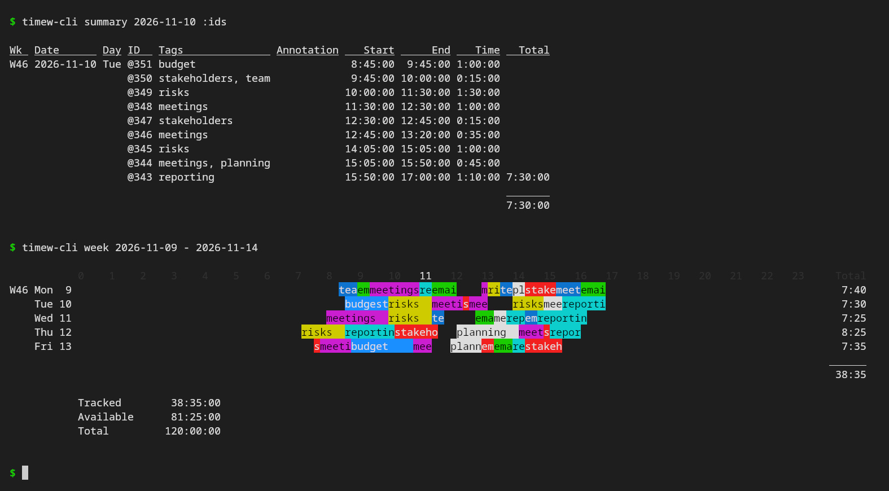
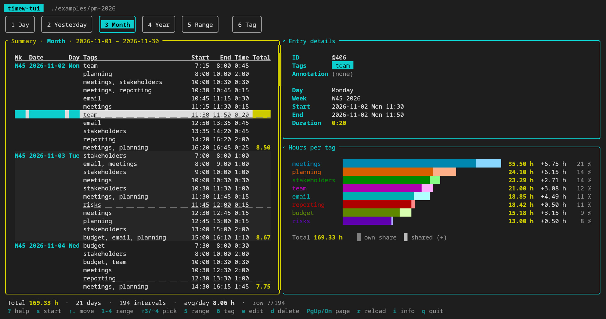

# timew-rs

timew-rs tracks your working time in the terminal. You start and stop
tracking with tags for projects, clients or activities, record or correct
time afterwards, and see where the time went in reports per day, week,
month or year, as tables, charts and hours per tag. Everything is stored
locally in plain text files.

It is a Rust implementation of [Timewarrior](https://timewarrior.net/) that
uses the same database format, so it works on an existing Timewarrior
database. It consists of two programs:

- **timew-cli:** the command line program, with the same commands and
  output as Timewarrior's `timew`.
- **timew-tui:** a terminal UI for browsing the data, starting and stopping
  tracking, and editing or deleting entries.




*timew-cli with the example data (`./examples/pm-2026`): `summary` of one day with IDs, and the `week` chart.*

<details>
<summary>Text version</summary>

```
$ timew-cli summary 2026-11-10 :ids

Wk  Date       Day ID   Tags               Annotation    Start      End    Time   Total
--- ---------- --- ---- ------------------ ---------- -------- -------- ------- -------
W46 2026-11-10 Tue @353 budget                         8:45:00  9:45:00 1:00:00
                   @352 stakeholders, team             9:45:00 10:00:00 0:15:00
                   @351 risks                         10:00:00 11:30:00 1:30:00
                   @350 meetings                      11:30:00 12:30:00 1:00:00
                   @349 stakeholders                  12:30:00 12:45:00 0:15:00
                   @348 meetings                      12:45:00 13:20:00 0:35:00
                   @347 risks                         14:05:00 15:05:00 1:00:00
                   @346 meetings, planning            15:05:00 15:50:00 0:45:00
                   @345 reporting                     15:50:00 17:00:00 1:10:00 7:30:00

                                                                                7:30:00

$ timew-cli week 2026-11-09 - 2026-11-14

           0    1    2    3    4    5    6    7    8    9    10   11   12   13   14   15   16   17   18   19   20   21   22   23     Total
W46 Mon  9                                           teaemmeetingsreemai    mriteplstakemeetemai                                      7:40
    Tue 10                                            budgestrisks  meetismee    risksmeereporti                                      7:30
    Wed 11                                         meetings  risks  te     emamerepemreportin                                         7:25
    Thu 12                                     risks  reportinstakeho   planning  meetsrepor                                          8:25
    Fri 13                                       smeetibudget    mee   plannememarestake                                              7:20

                                                                                                                                     38:20

           Tracked        38:20:00
           Available      81:40:00
           Total         120:00:00
```

</details>



*timew-tui with the same data, showing November 2026.*

<details>
<summary>Text version</summary>

```
 timew-tui   ./examples/pm-2026
╭───────╮ ╭─────────────╮ ╭─────────╮ ╭────────╮ ╭─────────╮   ╭───────╮
│ 1 Day │ │ 2 Yesterday │ │ 3 Month │ │ 4 Year │ │ 5 Range │   │ 6 Tag │
╰───────╯ ╰─────────────╯ ╰─────────╯ ╰────────╯ ╰─────────╯   ╰───────╯
╭ Summary · Month · 2026-11-01 – 2026-11-30 ────────────────────────────────╮╭ Entry details ──────────────────────────────────────────╮
│                                                                           ║│                                                         │
│  Wk  Date       Day Tags                          Start   End Time Total  █│  ID         @406                                        │
│  W45 2026-11-02 Mon team                           7:15  8:00 0:45        █│  Tags        team                                       │
│                     planning                       8:00 10:00 2:00        █│  Annotation (none)                                      │
│                     meetings, stakeholders        10:00 10:30 0:30        ║│                                                         │
│                     meetings, reporting           10:30 10:45 0:15        ║│  Day        Monday                                      │
│                     email                         10:45 11:15 0:30        ║│  Week       W45 2026                                    │
│                     meetings                      11:15 11:30 0:15        ║│  Start      2026-11-02 Mon 11:30                        │
│                     team                          11:30 11:50 0:20        ║│  End        2026-11-02 Mon 11:50                        │
│                     email                         12:50 13:35 0:45        ║│  Duration   0:20                                        │
│                     stakeholders                  13:35 14:20 0:45        ║│                                                         │
│                     reporting                     14:20 16:20 2:00        ║╰─────────────────────────────────────────────────────────╯
│                     meetings, planning            16:20 16:45 0:25  8.50  ║╭ Hours per tag ──────────────────────────────────────────╮
│  W45 2026-11-03 Tue stakeholders                   7:00  8:00 1:00        ║│                                                         │
│                     email, meetings                8:00  9:00 1:00        ║│  meetings      ███████████▊██  35.50 h  +6.75 h   21 %  │
│                     stakeholders                   9:00 10:00 1:00        ║│  planning      ██████████      24.10 h  +6.15 h   14 %  │
│                     meetings                      10:00 10:30 0:30        ║│  stakeholders  ███████▊▋       23.29 h  +2.71 h   14 %  │
│                     stakeholders                  10:30 11:30 1:00        ║│  team          ████████        21.00 h  +3.08 h   12 %  │
│                     meetings, planning            11:30 11:45 0:15        ║│  email         ██████▎▊        18.85 h  +4.49 h   11 %  │
│                     risks                         11:45 12:00 0:15        ║│  reporting     ██████▏         18.42 h  +0.50 h   11 %  │
│                     meetings                      12:30 12:45 0:15        ║│  budget        ██████▏         15.18 h  +3.15 h    9 %  │
│                     planning                      12:45 13:00 0:15        ║│  risks         ████▎           13.00 h  +0.50 h    8 %  │
│                     stakeholders                  13:00 15:00 2:00        ║│                                                         │
│                     budget, email, planning       15:00 16:10 1:10  8.67  ║│  Total 169.33 h    █ own share  █ shared (+)            │
╰───────────────────────────────────────────────────────────────────────────╯╰─────────────────────────────────────────────────────────╯
 Total 169.33 h  ·  21 days  ·  194 intervals  ·  avg/day 8.06 h  ·  row 7/194
 ? help  s start  ↑↓ move  1-4 range  ⇧3/⇧4 pick  5 range  6 tag  e edit  d delete  PgUp/Dn page  r reload  i info  q quit
```

</details>

## Contents

| Path | What it is |
| --- | --- |
| `timew-core/` | The `timew-core` library: the data model, database, configuration, dates and overlaps, shared by both programs |
| `timew-cli/` | The `timew-cli` command line program, built on `timew-core` |
| `timew-tui/` | The `timew-tui` terminal UI, built on `timew-core` |
| `examples/` | `generate-pm-data`, a generator for example data, plus two years of generated data |
| `docs/` | Technical documentation (see below) |

## Building

You need a Rust toolchain that supports edition 2024 (Rust 1.85 or later).

```sh
cargo build --release     # builds both programs
cargo test                # runs all tests
```

The programs are written to `target/release/timew-cli` and
`target/release/timew-tui`. To install them into `~/.cargo/bin`:

```sh
cargo install --path timew-cli   # timew-cli
cargo install --path timew-tui   # timew-tui
```

### Shorter names

For quicker typing, create aliases in your shell configuration
(`~/.zshrc` or `~/.bashrc`):

```sh
alias tw='timew-cli'
alias tu='timew-tui'
```

Then `tw summary :week` and `tu` work like the full names. For fish, use
`alias --save tw timew-cli` and `alias --save tu timew-tui`.

## Quick start with the example data

The repository includes a year of generated project-manager data
(`examples/pm-2025`, `examples/pm-2026`). See
[docs/example-data.md](docs/example-data.md).

```sh
export TIMEWARRIORDB=$PWD/examples/pm-2025

# timew-cli
./target/release/timew-cli summary 2025-03-03 - 2025-03-08
./target/release/timew-cli week 2025-03-03
./target/release/timew-cli export 2025-03-03 - 2025-03-04 meetings
./target/release/timew-cli get dom.tracked.count dom.tags.count
./target/release/timew-cli tags :lastyear

# timew-tui
./target/release/timew-tui
```

The data is from 2025, so the TUI's default view (the current month) is empty.
Press Shift+4 and pick 2025, or press `c` and enter `:lastyear`.

## timew-cli (command line)

`timew-cli` behaves like the `timew` command: same commands, same output,
same files. It was compared against the real `timew` byte for byte, and it
passes Timewarrior's own test suite (apart from the `undo` tests: there is
no `undo` command and no undo journal).

```sh
timew-cli start meetings client-a          # start tracking now
timew-cli stop                             # stop
timew-cli track 9am - 10:30 email          # record a past interval
timew-cli summary :week                    # this week's table
timew-cli week                             # this week's chart
timew-cli tag @2 budget                    # add a tag to the 2nd most recent
timew-cli modify end @1 16:45              # fix an end time
```

| Group | Commands |
| --- | --- |
| Tracking | `start`, `stop`, `track`, `continue`, `cancel` |
| Editing | `annotate`, `tag`, `untag`, `retag`, `delete`, `modify`, `move`, `lengthen`, `shorten`, `resize`, `split`, `join`, `fill`, `import` |
| Reports | `summary`, `day`, `week`, `month`, `gaps`, `tags`, `export`, `get`, extension reports |
| Other | `config`, `show`, `extensions`, `diagnostics`, `help` |

Dates can be ISO (`2025-03-01T08:00`), informal (`8am`, `yesterday`,
`monday`, `eom`) or range hints (`:week`, `:lastmonth`), durations
`1h`, `30min`. The configuration (`timewarrior.cfg`), exclusions, holidays,
and tag colors work as in Timewarrior (there is no `undo`; see below). The database is
found the same way (`$TIMEWARRIORDB`, `~/.timewarrior`, or the XDG
directories). Full reference, including the few deliberate differences:
[docs/timew-cli.md](docs/timew-cli.md).

## timew-tui (terminal UI)

A separate program for browsing the summary interactively:

- **Database:** opens `$TIMEWARRIORDB`, or Timewarrior's standard location
  if that isn't set.
- **Summary:** scrollable, with colors that alternate from week to week.
- **Details:** a side panel for the selected entry when the window is wide
  enough, otherwise a bottom panel opened with `Enter`.
- **Chart:** a bar chart of the hours per tag for the entries in the list,
  where neighboring bars always have clearly different colors. An entry with several tags is split evenly among
  them, so the bars add up to the total; the time shared with other tags is
  shown in a lighter shade. It's always shown below the details in a wide
  window; in a narrow one, `b` shows it.
- **Filters:** quick buttons for day, yesterday, month and year, plus the
  day of the selected entry (Shift+1), lists to pick a month (Shift+3) or
  one of the last 5 years (Shift+4), a form for your own date range (`5`),
  and a tag list (`6`).
- **Tracking:** `s` starts a new entry (asking for tags and annotation)
  or stops the running one; Shift+S starts one right after the last entry
  (stopping a running one). Times are kept to the full minute, so there
  are no hidden gaps of seconds. A running entry's details have a red
  border.
- **Editing:** `e` edits the start and end date and time, the tags and the
  annotation of the selected entry in the details panel; `a` adds a new
  entry right after it (30 minutes, starting when it ends); `d` deletes it
  after asking, optionally giving its time to the previous entry. Overlaps are refused, or adjusted with
  Shift+Enter (or Alt+Enter), and `u` undoes the last edit.
- **Tag completion:** in both forms, known tags are suggested while you
  type, ignoring case (the most used first); `Tab` or `→` takes the
  suggestion in the tag's stored spelling.
- **CSV export:** `x` writes the table as it is filtered, plus the
  annotations, to a CSV file (`timew-cli export :csv` does the same).
- **Uncounted entries:** an entry with a tag starting with one underscore
  (`_break`) is listed (its time in gray) but left out of all totals; the
  same applies to `timew-cli`'s totals.

Press `?` in the TUI for a list of all keys. Details: [docs/timew-tui.md](docs/timew-tui.md).

## Documentation

| Document | Contents |
| --- | --- |
| [docs/architecture.md](docs/architecture.md) | Crate and module layout, data flow, the invariants the code relies on, the test approach |
| [docs/timew-cli.md](docs/timew-cli.md) | CLI reference: commands, dates, ranges, hints, configuration, differences from Timewarrior |
| [docs/timew-tui.md](docs/timew-tui.md) | TUI user guide (keys, filters, layouts) and how it is built internally |
| [docs/data-format.md](docs/data-format.md) | The on-disk format: directory layout, `.data` lines, `tags.data`, `timewarrior.cfg`, IDs |
| [docs/example-data.md](docs/example-data.md) | The example data generator and the included data sets |

## Relationship to Timewarrior

This is a reimplementation in Rust, not a line-by-line translation. The behavior was worked out by reading
the Timewarrior C++ source (GothenburgBitFactory/timewarrior, `develop`
branch, commit `3699d2e`) and its tests, and by comparing against the real
`timew` binary. The tests in `timew-cli/tests/cli.rs` contain output captured from
`timew`, and `timew-cli` passes Timewarrior's Python test suite (except
for `undo`). The two
programs share the same files, so `timew-cli` and `timew-tui` can be used on
an existing Timewarrior database, and Timewarrior can keep using a database
that `timew-cli` wrote to.

### Differences from Timewarrior

The data format is the same, but `timew-cli` deliberately behaves
differently in a few places. The ones you are most likely to notice:

- **Underscore tags don't count:** an entry with a tag that starts with
  exactly one underscore (`_break`, `_private`; not `__x` or `x_y`) is
  still listed, but left out of all totals: the daily and grand totals of
  `summary`, the totals and the "Tracked" line of `day`, `week` and
  `month`, and in `timew-tui` the Total column and the totals and
  percentages of the Hours view. The whole entry is left out, also when it
  has other tags (`_break meetings`). Timewarrior has no such rule and
  treats these as ordinary tags, so **on the same database its totals
  include these entries** and are higher.
- **No undo:** there is no `undo` command and no undo journal
  (`data/undo.data`); changes are final. `timew-tui` can undo its last
  change with `u`. An `undo.data` written by Timewarrior is left alone.
- **New command `info`:** version, license and project page.
- **CSV export:** `export :csv` writes a CSV table instead of JSON.
- **Dates as ranges:** `2025-03` means the whole month and `2025-W10` the
  whole week (Timewarrior: only the first day); days are calendar days,
  also around daylight saving changes.
- **`annotate`** uses all words after the IDs as the annotation
  (Timewarrior: only the last word).

The complete list, with the smaller differences, is in
[docs/timew-cli.md](docs/timew-cli.md#differences-from-timewarrior).

## License

MIT, see [LICENSE](LICENSE). timew-rs is based on Timewarrior, which is
also MIT licensed; its copyright notice (Thomas Lauf, Paul Beckingham,
Federico Hernandez) is kept in the license. `timew-cli info` and the `i`
dialog in timew-tui show the version, license and copyright.
